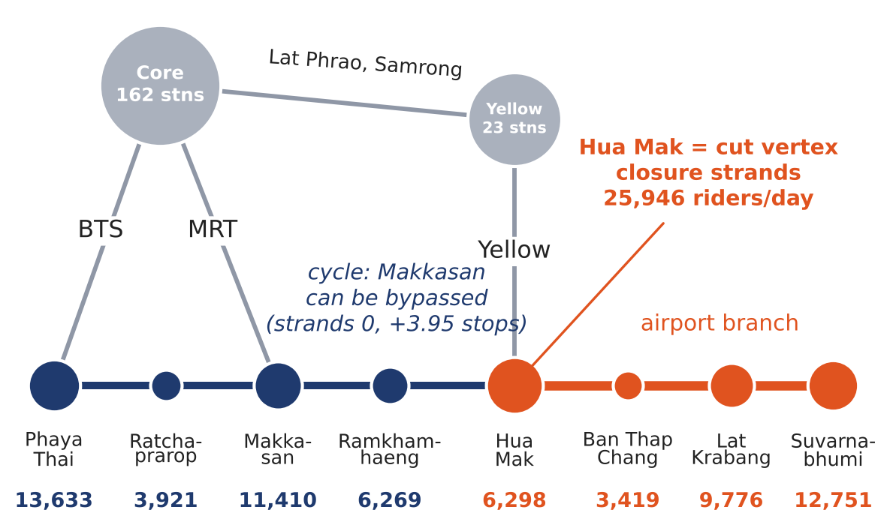

# MADT 7202 Mid-Term: which interchange should the Airport Rail Link plan its first bus bridge for?

Individual mid-term for MADT 7202 (Web and Social Network Analytics, NIDA).
**Decision studied:** where the Airport Rail Link (ARL) operations manager should stage the first standby bus bridge for an interchange closure.
**Data:** daily ARL entries and exits per station from the Department of Rail Transport (Jan 2022 – Mar 2026), plus a 193-station Bangkok rail network.
**Network:** stations are nodes; an edge is two adjacent stops on one line or a transfer walkway. Each interchange is removed in turn, and the ARL riders who lose every rail route to the rest of the network are counted (*stranded riders*).

**Answer:** Hua Mak. It is the quietest of the ARL's three interchanges (6,298 riders/day), but it is a **cut vertex**: closing it strands **25,946 riders/day (38.5%)** at Suvarnabhumi, Lat Krabang and Ban Thap Chang. Phaya Thai and Makkasan strand nobody.

## Run it (no other files needed)

1. Open the notebook in Google Colab:
   `https://colab.research.google.com/github/daruntoey/madt7202-arl-interchange/blob/main/MADT7202_ARL_interchange.ipynb`
2. Runtime -> Run all (about 1 minute).
3. The last section ("9. Check against the reported results") should print **All reported results reproduced.**

The three input files are embedded in the notebook (gzip + base64). They are written to `data/` if missing and checked against their SHA-256, so the notebook also runs offline. The same files are in `data/` for reading.

To test a different weighting window or transfer cost, edit `WEIGHT_START`, `WEIGHT_END` or `TRANSFER_COST` in section 1.

## Files

| File | Purpose |
|---|---|
| `MADT7202_ARL_interchange.ipynb` | The analysis (executed, with outputs) |
| `report/ARL_interchange_report.pdf` | The one-page A4 report |
| `data/drt2566_02.csv` | ARL entries/exits per station per day, 1 Jan 2022 – 31 Mar 2026 (12,408 rows) |
| `data/stations_cc0.csv`, `data/transfer_links_cc0.json` | Base network: 125 stations and 9 transfer links (2023) |
| `results/results_main.csv` | Stranded riders, own riders and extra stops for each of 18 interchanges |
| `results/results_all_pairs.csv` | Named alternative: unweighted all-pairs ranking (city view) |
| `results/results_robustness.csv` | 4 weighting windows × transfer cost 1 or 3 |
| `figures/page_figure.png` | The figure printed on the A4 page |

## Data sources and legal basis

| Source | Licence | How obtained |
|---|---|---|
| Department of Rail Transport, dataset `drt2566_02` ([MOT open data](https://datagov.mot.go.th/dataset/drt2566_02)) | Open Data Common | Downloaded by hand in a browser: the portal's `robots.txt` disallows automated access, so it was not scraped |
| [`Gusb3ll/thailand-public-train-data`](https://github.com/Gusb3ll/thailand-public-train-data) | CC0 1.0 | `git clone` |
| Yellow, Pink (+ Muang Thong Thani branch), Dark Red and Light Red lines: Wikipedia station tables | CC BY-SA 4.0 | Station order and interchanges transcribed into the notebook (section 3b) |

No personal data: the ridership file holds station-day counts only.

## Things to know

- **Ridership exists only for the ARL.** BTS and MRT do not publish station counts, so the 185 non-ARL destinations are weighted equally, and the counts are entries/exits, not origin–destination trips.
- **Failure model.** Removing a node assumes the track through the station is blocked (flood, power, signal). If a closure is station-only and trains run through, nobody beyond the station is stranded, and the ranking would favour Phaya Thai (13,633 own riders). This is the main limitation in the report.
- **Positions of added stations are interpolated** between known anchor stations and are used for drawing only; the analysis uses topology, not coordinates.
- **Robustness:** Hua Mak ranks first for 2022, 2023, 2024 and 2025–26 weights, with a transfer cost of 1 or 3 stops, and with equal station weights. On the 2022 network (before the Yellow Line), Makkasan was the critical interchange (24,348 stranded).
- **Graph structure:** a sparse core–periphery network built from chains (79% of stations have degree 2; 11 cycles; 58 cut vertices). Hua Mak is a cut vertex; Makkasan sits on a cycle.
- The analysis code was drafted with help from Claude (an AI) and checked by running it end to end (section 9).
